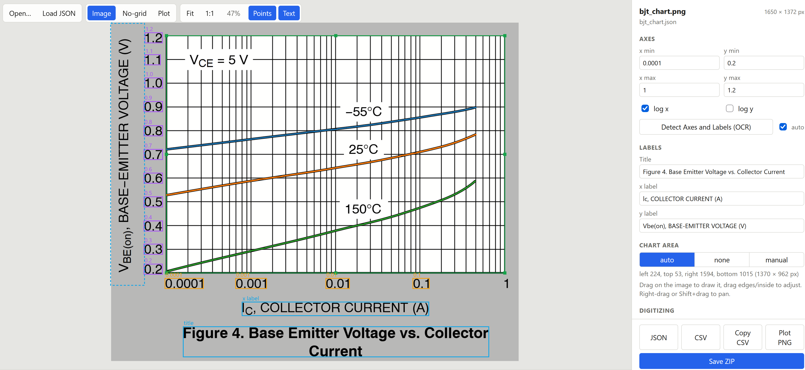

# DigiTool

Digitize curves from raster chart images (datasheet plots, scope captures,
scanned graphs) into CSV data points.

DigiTool finds the chart area, removes the grid and text, follows each trace
(also where traces cross or overlap) and scales the pixels to chart values.
Axis ranges, log/linear scales, the title and the axis labels are read from
the tick labels with OCR.



**Live demo:** [https://gorniak.eu/digitool/](https://gorniak.eu/digitool/)

The same engine is available in three forms:

| File            | Runs in                         | Use it for                                  |
|-----------------|---------------------------------|---------------------------------------------|
| `digitool.html` | any browser, no install         | interactive work: pick traces, adjust crop  |
| `digitool.py`   | Python 3 (numpy, Pillow)        | command line, scripts, batch, AI agents     |
| `digitool.m`    | MATLAB or GNU Octave            | MATLAB / Octave workflows                   |

All three read and write the same JSON configuration and produce the same CSV
files, so you can set a chart up in the browser and re-run it from a script.

## Web app (`digitool.html`)

Try the live demo at [https://gorniak.eu/digitool/](https://gorniak.eu/digitool/),
or open `digitool.html` locally in a browser (or host it, e.g. on GitHub Pages).
Everything runs locally in the page; only the OCR engine (Tesseract.js) is
downloaded from a CDN the first time it is used.

1. Drop a chart image (and optionally its `.json` configuration) on the page.
2. Check the chart area (green box) and the axes found by OCR.
3. Press **Pick** (`P`) and click on each trace. Name the traces in the panel.
4. **Save** downloads a ZIP with the image, `<name>.json`, the CSV files and
   `<name>_plot.png`.

## Python (`digitool.py`)

```sh
pip install numpy pillow matplotlib      # matplotlib: plot PNG
pip install pytesseract scipy            # optional: OCR wrapper, speed
# OCR also needs the Tesseract program: apt install tesseract-ocr,
# brew install tesseract, or the Windows installer
```

```sh
python digitool.py chart.png                         # config chart.json, or OCR + black trace
python digitool.py chart.png --pick 120 85 25oC --pick 140 160 150oC
python digitool.py chart.png --ocr --save-config     # re-read axes and labels, save JSON
python digitool.py chart.png --zip                   # as Save in the web app
python digitool.py -h                                # all options
```

| Option                        | Meaning                                                           |
|-------------------------------|-------------------------------------------------------------------|
| `--config FILE`               | configuration (default `<image stem>.json`)                       |
| `--pick X Y [NAME]`           | add a trace with the color at image pixel X, Y (repeatable)       |
| `--crop L T R B`              | chart area in image pixels (default: detected from the grid)      |
| `--ocr` / `--no-ocr`          | always / never read axes and labels with OCR (default: if missing)|
| `--out DIR`                   | output directory (default: next to the image)                     |
| `--save-config`               | write `<stem>.json` even if it exists                             |
| `--zip`                       | also write `<stem>.zip` (image, JSON, CSVs, plot)                 |
| `--save-steps`                | also write `<stem>_crop.png` and `<stem>_nogrid.png`              |
| `--no-plot`, `--show`         | skip the plot PNG / show the plot in a window                     |

`digitool.py` can also be imported: `digitize(image, config, traces)`,
`detect_axes(image, box)`, `scale_points(...)`, `pick_color(image, x, y)`.

## MATLAB / Octave (`digitool.m`)

```matlab
digitool('chart.png')
digitool('chart.png', 'pick', {120, 85, '25oC'; 140, 160, '150oC'})
r = digitool('chart.png', 'ocr', true, 'save_config', true, 'zip', true);
plot(r.traces(1).x, r.traces(1).y)
```

Options: `'config'`, `'pick'`, `'crop'`, `'ocr'` (`'auto'`/`true`/`false`),
`'out'`, `'save_config'`, `'zip'`, `'save_steps'`, `'plot'`, `'show'`. See
`help digitool`. Needs MATLAB R2016b+ or Octave 7+ (for `jsondecode`). The image
package / Image Processing Toolbox is used for speed when present; OCR needs
the `tesseract` program on the `PATH`.

## Outputs

For `chart.png`:

| File                                   | Content                                             |
|----------------------------------------|-----------------------------------------------------|
| `chart.csv` or `chart_<trace>.csv`     | one point per line, `x;y` (semicolon separated)     |
| `chart_plot.png`                       | plot of the digitized curves, for checking          |
| `chart.json`                           | configuration (written if missing)                  |
| `chart.zip`                            | all of the above and the image (`--zip`)            |

## Configuration (`<image stem>.json`)

```json
{
  "title" : "Figure 4. Base Emitter Voltage vs. Collector Current",
  "color" : [0, 0, 0],
  "min_x" : 0.0001,
  "max_x" : 1,
  "log_x" : true,
  "min_y" : 0.2,
  "max_y" : 1.2,
  "log_y" : false,
  "traces" : ["-55oC", "25oC", "150oC"]
}
```

| Key                         | Default | Meaning                                                                 |
|-----------------------------|---------|-------------------------------------------------------------------------|
| `min_x`, `max_x`            | OCR     | x values at the left and right edge of the chart area                   |
| `min_y`, `max_y`            | OCR     | y values at the bottom and top edge of the chart area                   |
| `log_x`, `log_y`            | OCR     | logarithmic axis                                                        |
| `title`, `x_label`, `y_label` | OCR   | plot texts                                                              |
| `grid_x`, `grid_y`          | OCR     | tick values found (informational)                                       |
| `color`                     | –       | `[r, g, b]` of the traces; `[0, 0, 0]` means any dark gray / black      |
| `traces`                    | `[]`    | names top to bottom, or `{"name": ..., "color": [r, g, b]}` per trace   |
| `crop`                      | `true`  | `true` detect chart area, `false` whole image, or `[left, top, right, bottom]` |
| `swap_x_y`                  | `false` | scan rows instead of columns (curves that are functions of y)           |
| `min_curve_y`, `max_curve_y`| –       | stretch a linear curve to these known min / max values                  |
| `color_tolerance`           | `10`    | max per-channel difference to the trace color                           |
| `gray_variance`             | `10`    | max RGB variance of a gray (black trace) pixel                          |
| `trace_min_width`           | `7`     | min thickness of black traces (thinner grid lines and text are removed) |
| `trace_min_span`            | `0.1`   | min trace width as a fraction of the chart width                        |
| `trace_min_gap`             | `7`     | min gap in pixels between separate traces                               |
| `trace_slope_span`          | `20`    | pixels used to extrapolate traces through crossings                     |
| `trace_slope_tolerance`     | `0.5`   | max slope deviation around crossings                                    |
| `trace_value_tolerance`     | `1.0`   | max value deviation (pixels) around crossings                           |
| `grid_min_fill`             | `0.6`   | min fraction of the chart a grid line covers                            |

## Tips

- Traces with several names but one `color` are separated top to bottom; give
  them in that order (left to right with `swap_x_y`).
- Thin black traces vanish with the grid: lower `trace_min_width` (2–4).
- Colored traces missing: raise `color_tolerance` (anti-aliased lines need
  30–100).
- Always look at `<stem>_plot.png` next to the original image.

## For AI agents

See [SKILL.md](SKILL.md) for a step-by-step procedure for coding agents
(Claude Code and others) to digitize charts with `digitool.py`.

## License

MIT License, Copyright 2023-2026 Radoslaw Gorniak.
